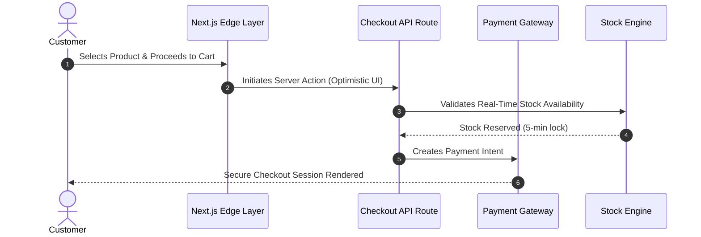

# High-Concurrency E-Commerce Fashion Platform (Architecture & Specs)

> **Live Storefront:** [jbdesignz.uk](https://www.jbdesignz.uk/)  
> **Architected & Engineered by:** Gurpreet Bhamra ([TFS Digital](https://www.tfsdigital.co.uk))  
> **Repository Scope:** Public Architecture & QA Showcase (Commercial Source Code Private)

---

## Executive Overview

A high-performance, headless e-commerce architecture built for high-concurrency retail environments. Engineered with a focus on sub-100ms core web vitals, resilient checkout pipelines, and automated end-to-end regression testing.

### Key Performance & Quality Metrics
* **Core Web Vitals:** 99+ Performance, 100 Accessibility (Lighthouse)
* **API Response Time:** <80ms average edge cache hit
* **Test Coverage:** Automated Playwright E2E suites running on every pull request

---

## Tech Stack & Infrastructure

* **Frontend:** Next.js (App Router), React, Tailwind CSS, TypeScript
* **State & Data:** Server-Side Rendering (SSR), Incremental Static Regeneration (ISR)
* **Testing & Automation:** Playwright, WCAG 2.1 AA Accessibility assertions, GitHub Actions CI/CD
* **Deployment:** Vercel Enterprise Edge Network

---

## System Sequence Diagram

